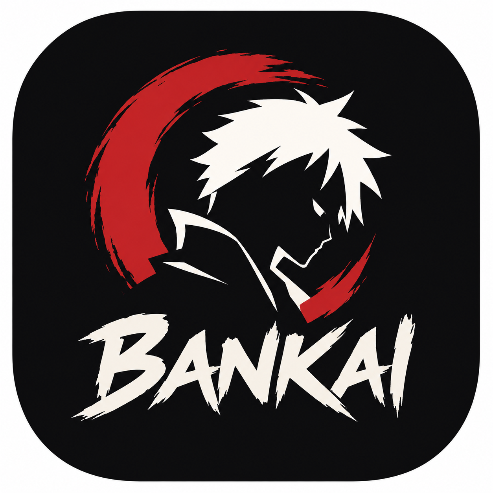

# bankai

  

<h1 align="center">Bankai</h1>
<h3 align="center">Browse. Watch. Download. Anime, simply.</h3>

  
  

**Bankai** is a free anime app for Android. Discover what's trending, what just aired and what's coming next, keep track of what you're watching, and download episodes to watch offline.

---

## ✨ Features

### Discover
- **Home feed:** trending, recently released, popular this season, upcoming next season, top rated and more, each with a **See all** button
- **Search** and a **Seasons** row on every show (Season 1, Season 2, ...)
- **My List** that adds a show when you start watching and shows **Continue** where you stopped

### Watch
- **Full-featured player:** quality, subtitles or dub, playback speed and fullscreen
- **Auto-play next episode** (you can turn it off in Settings)

### Download
- **Background downloads** with progress and a notification
- Choose your quality, pause and resume, and **watch offline**

### Made to last
- **Themes:** light, dark, or your phone's own colors
- **Updates and maintenance notices** delivered from this project, so the app can be fixed without waiting on a store

---

## 📱 Screenshots

  
  
  
  

---

## 📥 Download

Get the latest APK from the [Releases page](https://github.com/b3reket/bankai/releases/latest).

The SHA-256 of every APK is in its release notes. Check that yours matches before installing.

---

## 💖 Support

Bankai is free. Once a day it shows a short screen that points to a sponsor page. That is how the app pays for itself.

---

## ⚠️ Disclaimer

Bankai does not host or store any video files. It shows content from third-party sources, and details such as titles, posters and descriptions come from [AniList](https://anilist.co). Bankai is not affiliated with AniList or any content provider. You are responsible for how you use it.

© 2026 **b3reket**. All rights reserved.
